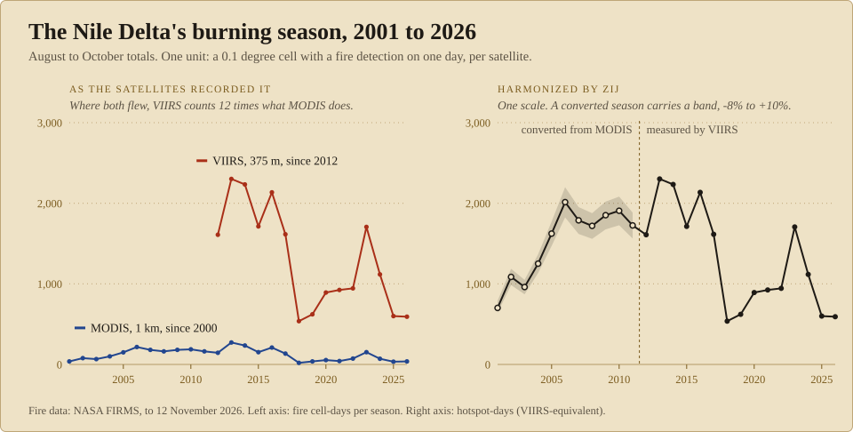
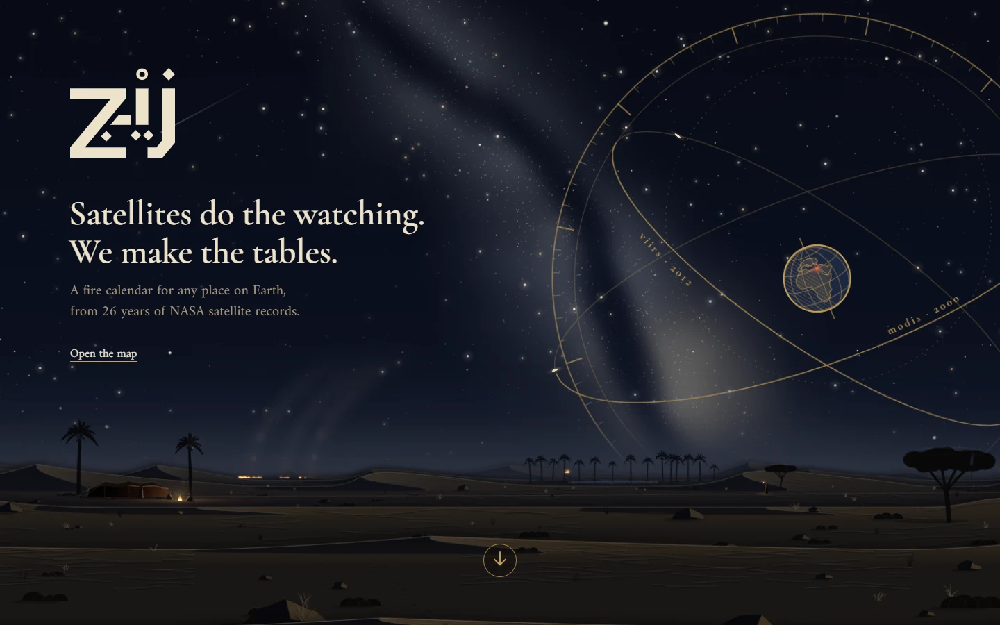
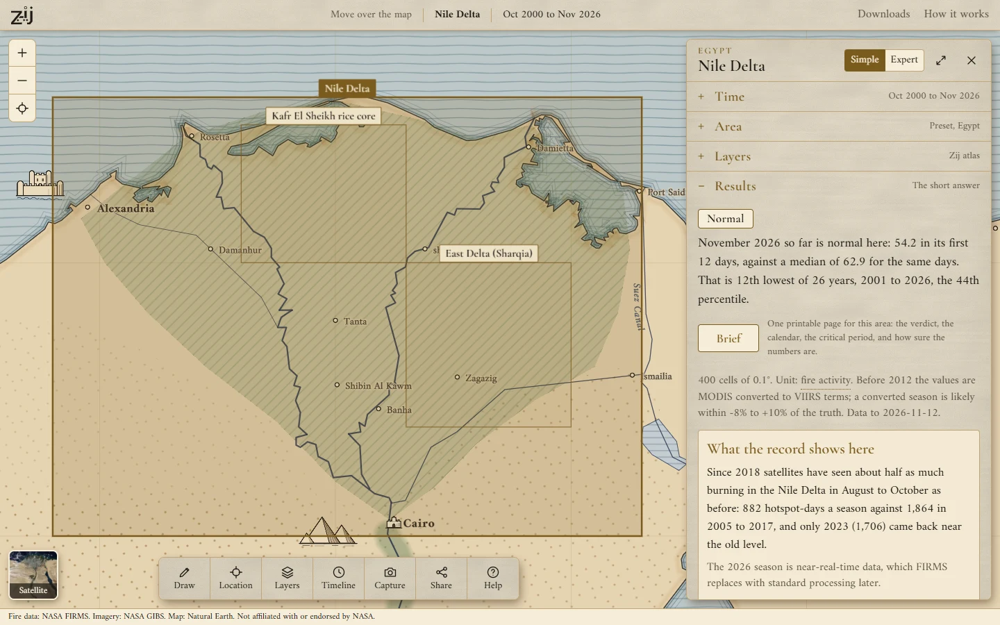
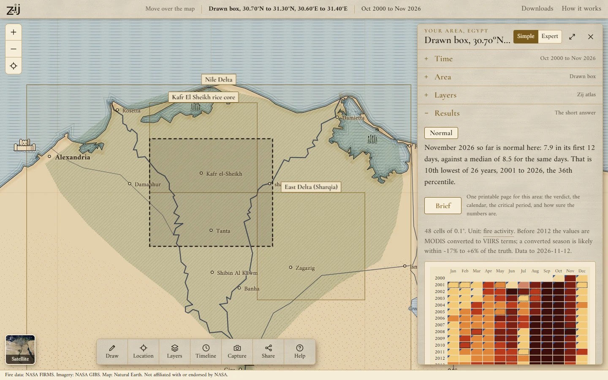
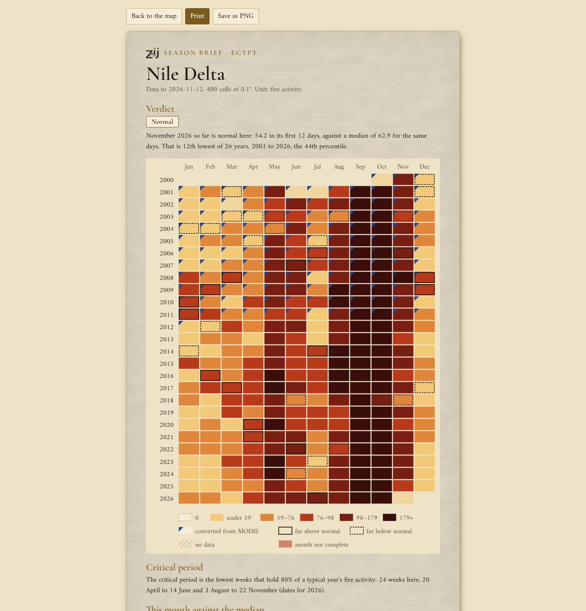
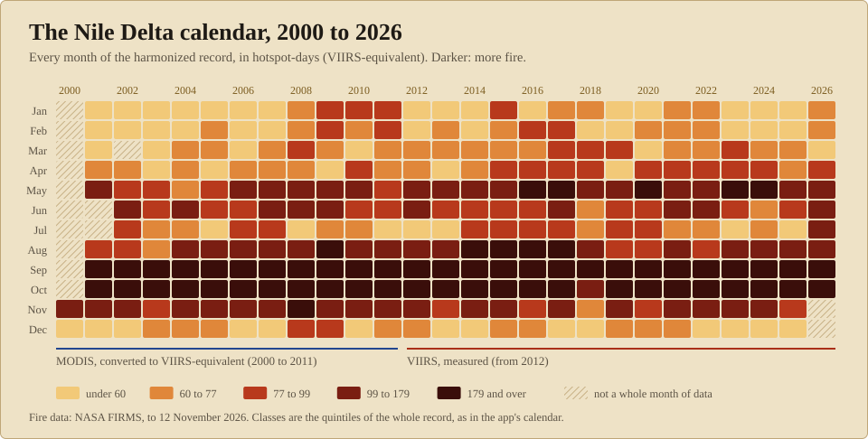
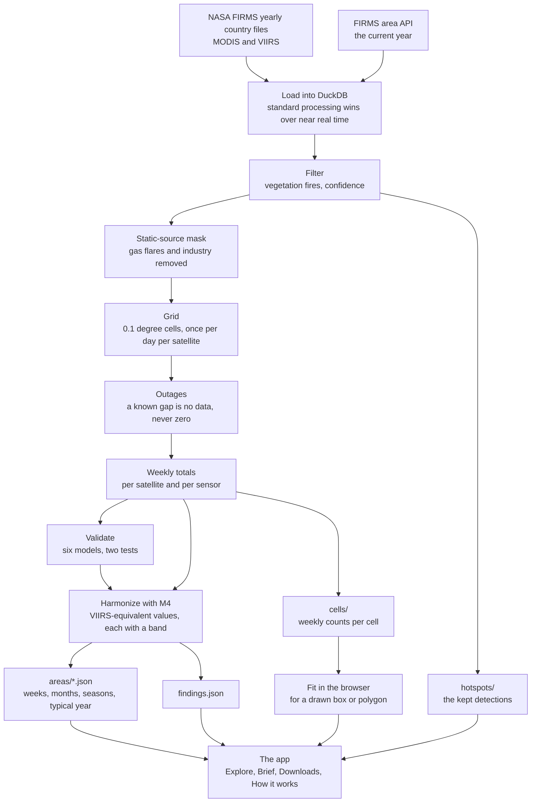
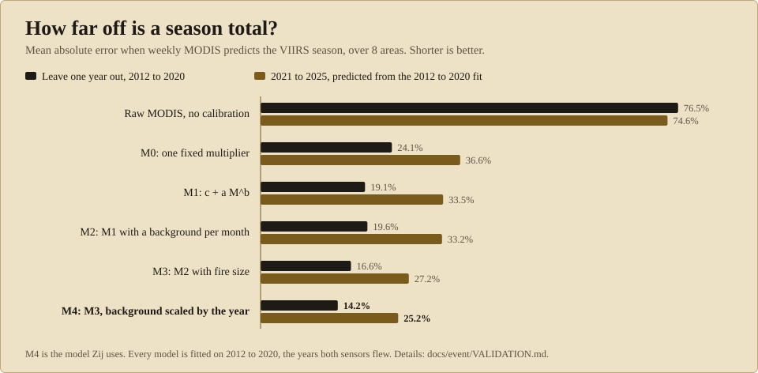

<picture>
  <source media="(prefers-color-scheme: dark)" srcset="docs/assets/hero-dark.svg">
  
</picture>

# Zij

Zij turns NASA's two satellite fire records, MODIS since 2000 and VIIRS since 2012, into one harmonized and validated record that anyone can explore for any area.

**[Live site: zij.watch](https://zij.watch)** · **Video:** `TODO: add the video link` · **Project page:** `TODO: add the Space Apps project page link`

[](LICENSE)
[](https://github.com/zij-watch/zij/actions/workflows/ci.yml)
[](https://zij.watch)

Built at NASA Space Apps Cairo, 13 to 14 November 2026, by Team Zij, for the challenge "Harmonization of MODIS and VIIRS Hot Spots". Contact: info@zij.watch.

## The problem

<!-- generated:problem -->
- NASA's fire record is two records: MODIS (1 km pixels, since 2000) and VIIRS (375 m, since 2012). VIIRS sees many more small fires.
- Over the Nile Delta in September to November, Suomi NPP reports 11 to 20 times as many fire pixels as Aqua in most years, and 42 times as many in 2018.
- So the two can't be joined as they are: read year against year, the record shows a jump in 2012 that is the sensor, not the burning.
<!-- /generated:problem -->

## What Zij does

- **One unit for both sensors.** A map square of 0.1 degree (about 10 km) with at least one fire detection on one day counts once, for each satellite that saw it. Counted this way, MODIS and VIIRS can be set against each other week by week.
- **One record.** VIIRS as measured from 2012; before that, MODIS converted to VIIRS-equivalent values by a model fitted on the years both flew. Every converted value carries a band.
- **A verdict in words.** For every area, and for any week or month: is this normal here, and how sure is that.
- **Any area.** Preset areas, or a box or polygon drawn on the map in Egypt, mainland Portugal or Argentina. A drawn area is fitted in the browser, with the same method as the presets.
- **The views.** The calendar, the typical year and its critical period, seasons, anomalies, the day view with every kept hotspot, and a printable season brief per area.
- **Everything can be taken away.** CSV downloads of the record and of the hotspots, with NASA's credit in every file header.
- **No data is never zero.** A week inside a satellite outage is marked as no data.

## Key numbers

<!-- generated:numbers -->
| | |
|---|---|
| The record | 1 November 2000 to 12 November 2026 |
| Satellites | 5: Terra, Aqua, Suomi NPP, NOAA-20, NOAA-21 |
| Fire detections kept | 6,278,021 (Argentina 5,869,767, Egypt 173,962, Portugal 234,292) |
| Detections left out | 543,332 low confidence; 858,110 at static sources (gas flares, industry); 18,563 offshore |
| Static-source mask | 932 cells of 0.01 degree with such detections on 20 or more days |
| Grid | 0.1 degree; the unit is hotspot-days (VIIRS-equivalent) |
| Known satellite gaps | 31, counted as no data, never as zero |
| Preset areas | 10, of which 8 are used for validation; plus any box or polygon drawn in Argentina, Egypt, Portugal |
| Season error, raw MODIS | 76.5% leaving one year out, 74.6% on 2021 to 2025 |
| Season error, harmonized (M4) | 14.2% and 25.2% |
| Nile Delta, M4 | 6.9% and 10.2%; a converted season's band is -8.4% to +10.4% |

From `app/public/data/method.json`, built 13 November 2026 with data to 12 November 2026.
<!-- /generated:numbers -->

## Screenshots

| | |
|---|---|
|  |  |
| The landing page | Explore: the Nile Delta, with the verdict |
|  |  |
| A drawn area, fitted in the browser | The season brief, one printable page |

Taken from the live site by `scripts/readme_screenshots.mjs`.

<picture>
  <source media="(prefers-color-scheme: dark)" srcset="docs/assets/calendar-dark.svg">
  
</picture>

## How it works



Each step, the files it writes and their columns are in [docs/PIPELINE.md](docs/PIPELINE.md). The format of the exported files is in [docs/event/DATA_CONTRACT.md](docs/event/DATA_CONTRACT.md), and every decision, with its reason, in [docs/event/DECISIONS.md](docs/event/DECISIONS.md).

## Validation

Can weekly MODIS predict weekly VIIRS? Six models are fitted on the years both sensors flew, and each is tested twice: leaving one year out, and predicting later years it has never seen. The figure is the mean absolute error of the season total.

<picture>
  <source media="(prefers-color-scheme: dark)" srcset="docs/assets/validation-dark.svg">
  
</picture>

<!-- generated:validation -->
| Model | Leave one year out, 2012 to 2020 | 2021 to 2025 | Nile Delta alone |
|---|---|---|---|
| Raw MODIS, no calibration | 76.5% | 74.6% | 91.8% and 93.4% |
| M0: one fixed multiplier | 24.1% | 36.6% | 25.1% and 23.6% |
| M1: c + a M^b | 19.1% | 33.5% | 14.0% and 17.8% |
| M2: M1 with a background per month | 19.6% | 33.2% | 10.0% and 12.0% |
| M3: M2 with fire size | 16.6% | 27.2% | 9.5% and 11.7% |
| **M4: M3 with the background scaled by the year's activity** | 14.2% | 25.2% | 6.9% and 10.2% |
<!-- /generated:validation -->

Per area and per year: [docs/event/VALIDATION.md](docs/event/VALIDATION.md). Small drawn areas: [docs/event/SMALL_AREAS.md](docs/event/SMALL_AREAS.md).

## Findings

Three questions, answered from the harmonized record. The full tables, with every comparison that was made, are in [docs/event/FINDINGS.md](docs/event/FINDINGS.md).

<!-- generated:findings -->
### 1. Did burning in the Nile Delta change after Egypt's 2004 ban?

Cannot tell whether the ban changed burning. What the record shows is that detected burning did not fall after 2004: the August to October total averaged 916 in 2001 to 2003 and 1,804 in 2005 to 2011, +97% (+62% to +137%). The rise had started before the ban, there are only three seasons before it, and one of them is Terra alone. The seasons since 2018 are back near the level of before the ban (-4%, -13% to +6%). MODIS night detections are too few to show a move between day and night.

Caveats:

- There is no record of what would have burned without the ban. A ban that slowed a rise and a ban that did nothing look the same here.
- The seasons before 2012 are converted from MODIS. Their bands are measured on the years both sensors flew, and nothing can test the conversion before VIIRS existed.
- MODIS looks four times a day. Burning between overpasses is never counted.

### 2. The Delta since 2018

The Nile Delta's August to October seasons of 2018 to 2026 average 882 hotspot-days, 53% below (50% to 55% below) the 1,864 of 2005 to 2017. It is not a steady low: 2023 came back to 1,706. Kafr El Sheikh is 61% below (60% to 64% below) and Sharqia 56% below (53% to 58% below): both fell by more than half. Kafr El Sheikh is 5 points further down, a gap smaller than what leaving out one season does to either figure, so whether it fell further: cannot tell. The lowest season is 2026 in Kafr El Sheikh and 2018 in Sharqia.

Caveats:

- The 2026 season is near-real-time data (100% of its kept VIIRS detections). FIRMS replaces those rows with standard processing later. Without 2026 the Nile Delta is 51% below.
- The fall is mostly at the early-afternoon overpass: on Suomi NPP alone, -59% by day and -23% by night against 2012 to 2017.
- A fall in detections is not a measured fall in straw burned. Fewer hotspot-days can come from less burning, from smaller or shorter fires, or from burning at hours no satellite passes.

### 3. One sentence per area

| Area | What the record shows |
|---|---|
| Nile Delta, Egypt | Since 2018 satellites have seen about half as much burning in the Nile Delta in August to October as before: 882 hotspot-days a season against 1,864 in 2005 to 2017, and only 2023 (1,706) came back near the old level. *The 2026 season is near-real-time data, which FIRMS replaces with standard processing later.* |
| Kafr El Sheikh rice core, Egypt | In the rice fields of Kafr El Sheikh the last two seasons are the quietest VIIRS has measured: 65 hotspot-days in 2025 and 41.3 in 2026, against 395 a season in 2012 to 2017. *The 2026 season is near-real-time data, which FIRMS replaces with standard processing later.* |
| East Delta (Sharqia), Egypt | In Sharqia the fall came in a single year: 535 hotspot-days in the 2017 season and 98.5 in 2018, 82% fewer, both measured by VIIRS with no conversion. |
| Upper Egypt sugarcane belt, Egypt | The sugarcane belt of Upper Egypt burns every February to April and shows no fall like the Delta's: 225 hotspot-days a season in 2018 to 2026 against 183 in 2005 to 2017 (+23%, +10% to +31%). |
| Portugal mainland, Portugal | Mainland Portugal's August to October burning since 2018 runs at less than 40% of what it was: 339 hotspot-days a season against 875 to 987 in 2001 to 2017, and no season since 2018 has passed 555. *The conversion runs high in this area (+2% to +22% on season totals), so the converted mean, 1,004, sits above its own range; the sentence uses the range.* |
| Northern Portugal, Portugal | Northern Portugal has two burning seasons, not one: a typical March has 91 hotspot-days and a typical August 191, while May, June and November each have 9 to 35. |
| Central Portugal (Pinhal), Portugal | In central Portugal 2017 stands far above every other whole year VIIRS has measured (2013 to 2025): 474 hotspot-days across the year, more than twice the next (197 in 2025), with 182 of them in June and October, outside the usual July to September season. *Two years converted from MODIS are as high or higher: 2003 and 2005, in converted_years_above.* |
| Alentejo, Portugal | The Alentejo burns most after the summer, not during it: a typical October has 51 hotspot-days and a typical November 33, against 7 to 12 in each month from June to September. |
| Parana Delta, Argentina | In the Parana Delta four seasons stand far above the rest: 2004, 2006, 2008 and 2020 each had about 3,000 hotspot-days in July to September (2,964 to 3,274), five times the median season of 588. *2004, 2006 and 2008 are converted from MODIS: their ranges are in big_seasons. 2020 is measured.* |
| Chilecito, Argentina | The fire near Chilecito of 27 July to 1 August 2026 gave about 900 VIIRS detections but burned in only 8 grid cells, so the 2026 season counts 43 hotspot-days, inside the range of other years (19 to 64): this unit counts places and days with fire, not the size of a fire. |

The names in a note (`big_seasons`, `converted_years_above`) are fields of `app/public/data/findings.json`.

Caveat for every area: the unit counts places and days with fire. It is not burned area, not smoke, and not the number of fires. Ranges on converted (MODIS) seasons are the 10th to 90th percentile of the conversion error on 2012 to 2020. A period's range takes every converted season at one end of its band; a change's range sets one period's low against the other's high.
<!-- /generated:findings -->

## Limits

- **The unit counts places and days with fire.** It is not burned area, not smoke, not emissions, and not the number of fires.
- **Satellites see only what burns as they pass.** A fire lit and out between overpasses is never counted. Small, short or smoke-covered fires are missed by both sensors.
- **The band is not a confidence interval.** It is the 10th to 90th percentile of the conversion's error on the years both sensors flew. Nothing can test the conversion before VIIRS existed.
- **Three countries.** The record covers Egypt, mainland Portugal and Argentina. A shape that spans two countries is not handled.
- **Small areas.** An area with too few MODIS fire weeks gets a blended fit with a warning, or raw counts only (see [docs/event/SMALL_AREAS.md](docs/event/SMALL_AREAS.md)).
- **The newest weeks are near real time.** FIRMS replaces them with standard processing later, and the numbers for those weeks then change.
- **The record describes; it does not explain.** It can say that detections fell or rose. It cannot say why.

## Reproduce it

Every number Zij shows comes out of `pipeline/` from public NASA FIRMS files. [REBUILD.md](REBUILD.md) lists what to download, the exact commands, how long each takes, and how to compare the result with what is committed. On a machine that has the raw files:

```
python scripts/verify_rebuild.py --raw <folder with the raw files>
```

The app:

```
cd app
pnpm install
pnpm dev
```

The README's graphics, tables and findings are made from the exported files by `python scripts/readme_assets.py`. CI runs the app's library tests, checks that this page is up to date, and builds the app.

## Data and credits

### Data sources

- **NASA FIRMS active fire detections**: MODIS Collection 6.1 (Terra, Aqua) and VIIRS 375 m (Suomi NPP, NOAA-20), yearly country files for Egypt, Portugal and Argentina, 2000 to 2025, and the FIRMS area API for 2026 (standard processing where it exists, near real time after, NOAA-21 included). https://firms.modaps.eosdis.nasa.gov
- **NASA GIBS** true-colour imagery (MODIS Terra, VIIRS Suomi NPP, VIIRS NOAA-20 corrected reflectance), as the app's satellite basemap.
- **Natural Earth** (1:10m, public domain): country outlines, used to clip the API's boxes to each country; and land, rivers, lakes, borders, places and physical regions, simplified, as the app's offline basemap. https://www.naturalearthdata.com

We acknowledge the use of data and imagery from NASA's Fire Information for Resource Management System (FIRMS) (https://earthdata.nasa.gov/firms) and Global Imagery Browse Services (GIBS), part of NASA's Earth Science Data and Information System (ESDIS).

Zij is not affiliated with or endorsed by NASA.

### What is shipped from FIRMS

The raw FIRMS archive (the yearly country files and the API pulls, about 1.2 GB) is not in this repository. The pipeline reads it from a folder outside the repository and writes its working files to `data/`, which git ignores.

Three things made from it are committed in `app/public/data/`, because the deployed app reads them:

- `areas/`: weekly, monthly and seasonal totals for the 10 preset areas.
- `cells/`: weekly counts per 0.1 degree cell and satellite, for drawn areas (`docs/event/CELLS_FORMAT.md`).
- `hotspots/`: a filtered copy of the kept FIRMS detections (position, time, satellite, confidence, fire radiative power), for the day view and the hotspots CSV: all of Egypt and Portugal, and in Argentina around Chilecito and the Parana Delta (`docs/event/HOTSPOTS_FORMAT.md`).

FIRMS is NASA open data. It is credited here, in the app's footer and in the header of every downloaded CSV.

### Libraries

| Library | Used for | Licence |
|---|---|---|
| [DuckDB](https://duckdb.org) | loading, filtering and aggregating the detections | MIT |
| [pandas](https://pandas.pydata.org) | the checkpoint tables | BSD-3-Clause |
| [NumPy](https://numpy.org) | arrays under pandas | BSD-3-Clause |
| [Apache Arrow (PyArrow)](https://arrow.apache.org) | Parquet | Apache-2.0 |
| [Shapely](https://shapely.readthedocs.io) | which API rows fall inside a country outline | BSD-3-Clause |
| [uv](https://docs.astral.sh/uv/) | Python and package management | Apache-2.0 or MIT |

Exact versions are in `pipeline/pyproject.toml` and `pipeline/uv.lock`. The app (`app/package.json`, `app/pnpm-lock.yaml`):

| Library | Used for | Licence |
|---|---|---|
| [Next.js](https://nextjs.org) and [React](https://react.dev) | the app | MIT |
| [MapLibre GL JS](https://maplibre.org) | the map | BSD-3-Clause |
| [zij-map](https://github.com/zij-watch/zij-map), the Zij atlas, by our team | the look of the map: style, patterns, signs and drawings | by our team; its repository has no licence file yet |
| [Apache ECharts](https://echarts.apache.org) | the charts | Apache-2.0 |
| [Terra Draw](https://terradraw.io) and its MapLibre adapter | drawing a box or polygon on the map | MIT |
| [Radix UI](https://www.radix-ui.com) primitives (Select, Popover, Tabs, Checkbox, Tooltip, Dialog) | the controls: keyboard, focus and screen-reader behaviour | MIT |
| [React DayPicker](https://daypicker.dev) | the date pickers | MIT |
| [Fontsource](https://fontsource.org) packages of Cormorant Garamond, Reem Kufi and Amiri | fonts, bundled | fonts: SIL Open Font License 1.1 |
| [TypeScript](https://www.typescriptlang.org), [ESLint](https://eslint.org) | development | Apache-2.0, MIT |

## Before the event

- **Research and method decisions were done before the event.** We studied the challenge and the two sensors, tested methods, and wrote a spec. That work is in private repositories (available to the organizers on request). During the event we read its spec, its notes and its reference numbers. No code, notebook or generated data from it is in this repository.
- **The public FIRMS files were downloaded before the event.** They are public NASA data, not project work. The raw archive is not committed. What the app needs from it is: a filtered copy of the kept hotspots and the weekly counts per cell (see "What is shipped from FIRMS" above).
- **The design system was made before the event.** From it this repository takes the colour and font tokens, the Seal (the mark that reads Zij and زيج; `Seal` in `app/components/Shell.tsx`, and the favicon set drawn from it by `app/scripts/icons.mjs`), and the paper material: the grain file `app/public/paper-grain.svg` and the sheet's shading, shadow and scrollbar rules in `app/app/globals.css`. The landing page at `/` is also from it: `app/landing-src/` holds its page, script, tokens, materials and patterns unchanged, and `app/scripts/build-landing.mjs`, written during the event, puts the real record into it. Nothing else of it is here.
- **All other code in this repository was written during the event.**
- **AI assistance: Claude and Claude Code (Anthropic).** They write code and documentation here under our direction. We decide the method, log every decision in `docs/event/DECISIONS.md`, and check the output against our own research numbers before building on it. No AI-generated images, video or audio are in this repository.

## Team and roles

Team Zij, Cairo. Contact: info@zij.watch.

| Member | Role |
|---|---|
| `TODO: name` | `TODO: role` |

## Licence

Apache-2.0, see [LICENSE](LICENSE). To cite Zij, see [CITATION.cff](CITATION.cff).
